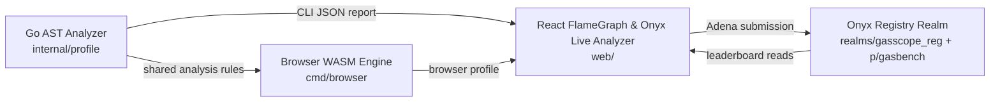

# GasScope

Static Gas & Allocation Profiler + FlameGraph IDE + On-Chain Registry for Gno.land

[](https://youtu.be/YKaQ05D91SE)

[Watch on YouTube](https://youtu.be/YKaQ05D91SE)

- [Web App](https://gas-scope-sigma.vercel.app)
- [On-Chain Registry (`gasscope_reg` on Onyx)](https://onyx.testnets.gno.land/r/g1832jd5gytypzj48d0328r2sqvv2x38zj0zryuq/gasscope_reg)

<!-- TODO: Add YouTube demo video link -->

## Try the web app

1. Open **Demo**, select a function in the FlameGraph, and compare its current gas estimate with the estimate after fixing its hotspots. Switch to **Call tree** to trace calls and realm crossings.
2. Open **Live**, enter a realm such as `gno.land/r/gnoland/blog`, and select **Analyze realm**. GasScope fetches public source from Onyx and analyzes it in your browser. You can also import a CLI JSON report.
3. Open **Leaderboard** to browse submissions or publish your report with Adena on Onyx (`onyx-1`). Imported reports require a realm path. The registry ranks profiles by estimated gas points and marks submitter attestations.

## Architecture



The CLI and browser share the Go analyzer. The browser reads realm source through Onyx's `vm/qfile` endpoint. The registry stores caller-owned reports up to 32 KiB. The reusable Gno package `p/gasbench` lives in `packages/gasbench` and lets realm authors count operations and assert budgets.

## Static hotspot rules

| Rule | What it flags |
| --- | --- |
| `CROSS_REALM_IN_LOOP` | Cross-realm calls inside a loop |
| `UNBOUNDED_AVL_ITER` | AVL iteration without a visible bound |
| `LOOP_STRING_CONCAT` | Repeated string concatenation inside a loop |
| `UNBOUNDED_SLICE_APPEND` | Slice growth from appends inside a loop |
| `LARGE_STATE_SERIALIZE` | Serialization of potentially large state |
| `STORAGE_WRITE_IN_LOOP` | Repeated storage writes inside a loop |

Static gas points combine function and call-site costs with rule penalties. Fixable savings estimates the effect of removing those penalties. Actual VM gas depends on execution paths and input sizes. When available, the benchmark command reports VM gas and elapsed time from `gno test -v`.

## Quickstart

### CLI

From the repository root, run either command to generate `gasscope-report.json` and `gasscope-report.svg`.

```sh
go run ./cmd/gasscope analyze ./...
go run ./cmd/gasscope bench ./...
```

Install the Gno CLI to collect test measurements. Without it, `bench` produces a static report with a fallback note.

### GitHub Actions CI

The included PR workflow runs automatically in this repository. To use it in another repository containing the GasScope CLI source, copy [the workflow](.github/workflows/gasscope-ci.yml) to `.github/workflows/action.yml`. It runs static analysis on pull requests, uploads the JSON and SVG reports, and compares the score with the base commit. Set the repository variable `GASSCOPE_MAX_INCREASE` to a nonnegative integer to enforce a gas-point budget.

### Local Web UI

With Node.js 22 and Go on your PATH, run the following and open the URL printed by Vite.

```sh
cd web
npm ci
npm run dev
```

Run `npm run build` in `web/` for a production build and `go test ./...` from the repository root to verify the Go code.
